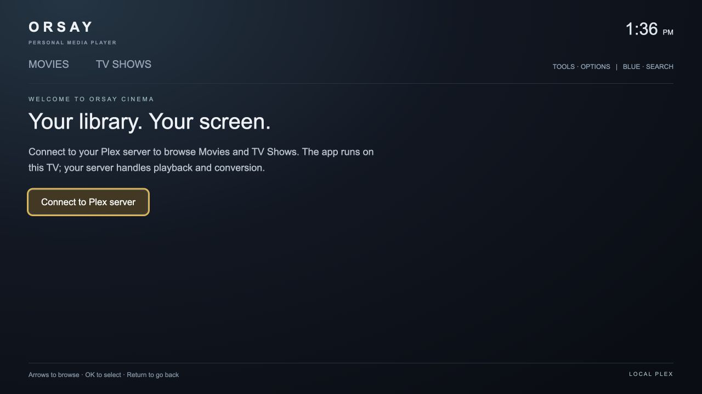
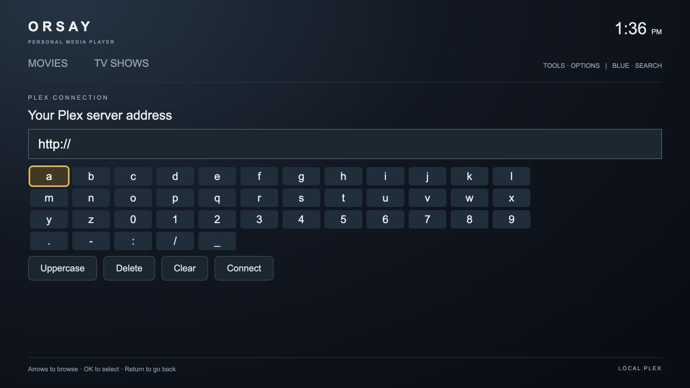
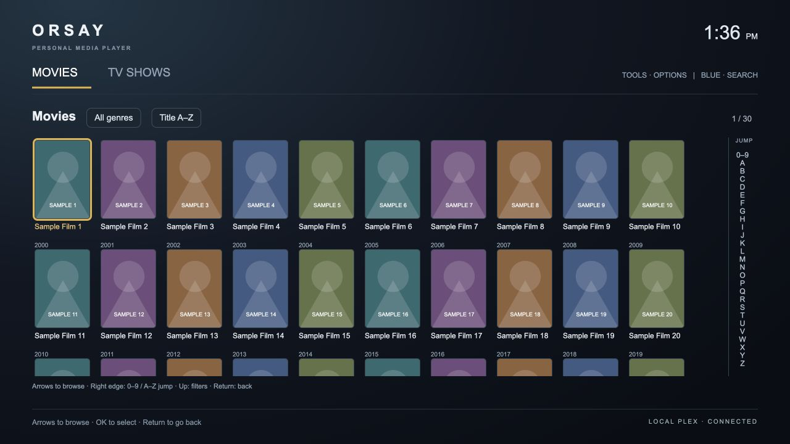

# Orsay Cinema

A small, independent personal-media player for Samsung's **pre-Tizen Orsay Smart TVs**, compatible with Plex Media Server.

**Community beta.** The standalone playback and subtitle workflow has been tested on a Samsung UN55H6203 with firmware 1230. The new generic connection-setup screen has automated checks but still needs testing on additional TVs. Other Orsay models are unverified. This is not a Tizen application.

## Screenshots

The browser previews below show the real interface. The poster-wall image uses synthetic titles and original sample artwork, not a personal library or proof of TV playback.





## What it does

- Movies and TV Shows, without recommendation feeds.
- Ten-column poster wall with row navigation, genre filters, title/release-date sorting, and a 0–9 / A–Z jump rail.
- Series, seasons, episodes, title search, and locally saved resume positions.
- Direct HTML video for a conservative set of compatible H.264/AAC MP4 files.
- Automatic compatibility playback using Plex's on-demand transcoder and Samsung's native HLS player.
- Pause, resume, skip controls and a selectable progress bar.
- Subtitle track selection and English OpenSubtitles search/download through your Plex server. Alternate release versions can be selected for timing differences.
- Fully bundled TV interface: **no coding computer, proxy, or companion service is required after installation**.

You still need a reachable Plex server. Subtitle searches/downloads need internet connectivity and whatever access Plex/provider policy requires. Transcoding capability, performance and entitlement depend on your Plex setup.

## Prefer AI-assisted setup?

Open this repository in **Codex, Claude Code, or another local coding agent**, then copy the [guided setup prompt](AI_SETUP_PROMPT.md). The agent can run checks, build the widget, prepare a multi-app-safe sync catalog, watch the download log, and guide you through the TV remote steps. You confirm actual playback and the final installation-server-off test.

The same file includes a shorter troubleshooting prompt. [AGENTS.md](AGENTS.md) provides durable project guidance, and [CLAUDE.md](CLAUDE.md) points to it for other workflows. No OpenAI/Anthropic API integration or API key is built into the TV app.

## Install

Requirements: Python 3 on an installation computer, a compatible Samsung TV with developer app synchronization, and a Plex server you are authorized to use. Node.js is only needed for development tests.

1. Download this repository using GitHub's **Code → Download ZIP**, then extract it.
2. Open a terminal in the extracted folder. Replace the placeholder below with the installation computer's LAN address:

   ```sh
   python3 build.py --server-url http://YOUR_INSTALLATION_COMPUTER_ADDRESS
   python3 serve.py --bind 0.0.0.0 --port 80
   ```

   The installer uses HTTP port 80 on the tested TV. Allow local-network access through your firewall. Some operating systems require elevated privileges for that port; use your system's normal administrative procedure if needed. The server exposes only generated installation files in `dist/`, never your home folder.

3. On the tested H6203: **Menu → Smart Hub → Samsung Account → Sign In**. Use the developer account ID `develop`; the tested firmware accepted a blank password. Developer login behavior varies by firmware.
4. In Samsung Apps, highlight an installed app and hold **OK/Enter**. Choose **IP Setting**, enter the installation computer's address, save, then choose **Start User App Sync**. On the tested firmware, reopening IP Setting showed blank boxes even after saving; sync immediately after saving.
5. Reopen Smart Hub and launch **Orsay Cinema**.
6. Choose **Connect to Plex server**, then enter your Plex server's address, including its port (usually `32400`), using the on-screen keyboard. For example, use your own server hostname; no address is built into the app.
7. If your server requires authentication, configure **Tools → Set Plex token** with your own token. See [Plex's token documentation](https://support.plex.tv/articles/204059436-finding-an-authentication-token-x-plex-token/). Do not disable authentication or publish your token to make this app work.
8. Stop the installation server and test playback and subtitle search/download again. The TV app should connect directly to Plex.

### Keep other developer apps

Developer synchronization can replace developer-installed apps depending on the TV/firmware and the catalog. Keep all wanted apps in `dist/widgetlist.xml`, give each a distinct widget ID, and keep their ZIP files available. This builder updates **only OrsayCinema's entry** and preserves other entries. Do not replace an existing multi-app catalog with a one-app list.

Normal use doesn't require another sync. A factory reset, Smart Hub reset, uninstall or firmware change can still remove apps. Keep a source/ZIP backup.

## Remote controls

| Location | Controls |
|---|---|
| Poster wall | Arrows move between titles; Down loads later rows automatically |
| Filters/sorting | Up from the first row at the start of the list |
| Alphabet rail | Right past the final poster column, Up/Down to choose, OK to jump; Left/Return leaves the rail |
| Playback | OK shows controls; Up selects the progress bar; Left/Right previews 30-second steps; OK seeks; Down/Return cancels |
| Subtitles | Choose an existing track or Search OpenSubtitles; select a release version to download |
| Options | Tools; Blue opens title search |

## Limitations

- **No Plex account sign-in or server discovery.** This beta uses a configured server origin and optional manually entered token. Plex Home/managed-user flows have not been implemented.
- Legacy TV HTTPS/TLS support may be inadequate for some servers. Use an appropriately secured home network; this app does not bypass certificate validation or change server security settings.
- Native HLS seeks and subtitle changes may buffer noticeably. Captions may appear only after the new stream catches up. A subtitle with the wrong release timing can still be out of sync.
- Resume positions are stored on this TV, not synced to Plex's watched/progress history.
- English subtitle search is currently fixed; existing subtitle tracks in other languages can be selected. There is no subtitle-delay adjustment yet.
- The alphabet rail requests titles starting at the chosen sort key; choosing a letter switches to ascending title order. Genre filtering remains active. Reset the title sort to see the complete filtered list again.
- Only the first matching Movies/TV library and the first media part/version are used. Multi-library selection and multipart/version selection need work.
- No modern streaming-service apps, DRM bypass, movie files, or subscription access are included.

## Development

The app deliberately uses ES5-style JavaScript and basic CSS for old WebKit engines. Samsung's system JavaScript and native player APIs are supplied by the TV; they are referenced but not redistributed.

```sh
node --check app.js
node test.js
python3 -m unittest test_build.py
python3 build.py
```

The last command builds a widget ZIP in `dist/` without embedding an installation address. Repeated builds use fixed ZIP metadata. To prepare a sync catalog, supply `--server-url` as in the installation steps. Generated files and local configuration are ignored by Git.

Browser previews can test interface behavior; they cannot validate the Samsung player, remote codes or old WebKit compatibility. Report TV model, firmware, codec/container and reproducible steps in issues. Remove addresses, account data, tokens, library paths and private media information from reports.

## Independence and licensing

This project is not affiliated with or endorsed by Plex or Samsung. Plex and Samsung are trademarks of their respective owners. “Compatible with Plex Media Server” describes interoperability, not endorsement. The film-strip icon is original project artwork and is not the Plex chevron.

Project code and artwork are available under the [MIT license](LICENSE). That license does not grant rights to third-party trademarks, media, Samsung system software or Plex services. See [NOTICE.md](NOTICE.md), [PRIVACY.md](PRIVACY.md) and [SECURITY.md](SECURITY.md).

## Support

If this project helped you give an old TV another useful life, you can buy me a beer:

- [PayPal](https://paypal.me/MikeChandler82)
- [Venmo](https://venmo.com/MikeChandler82)
- [Cash App](https://cash.app/$MikeChandler1982)

Tips are optional; the app remains free and open source.
